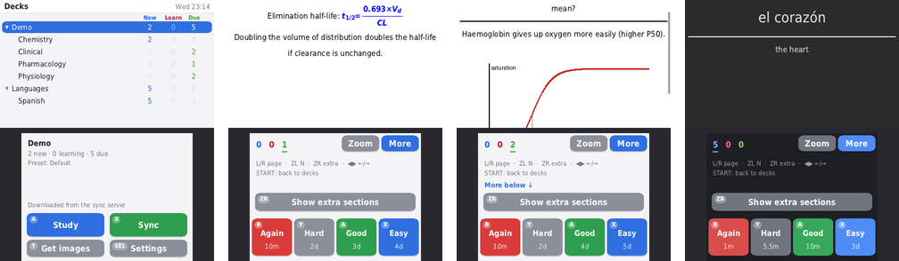
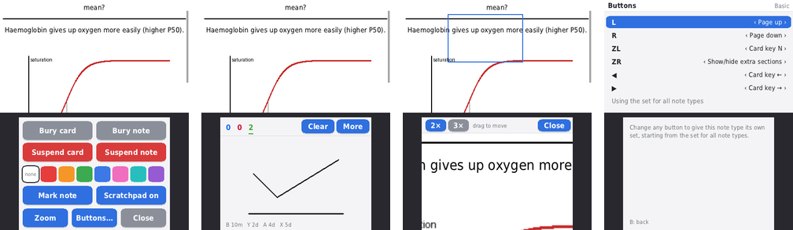

# Clamshell

An Anki-compatible flashcard client for the New Nintendo 3DS. Clamshell is unofficial: it works with your [Anki](https://apps.ankiweb.net/) collection, but isn't made by the Anki team. It reviews your own Anki collection with exactly the same scheduling as desktop Anki (FSRS included), shows cards with their HTML, CSS, images, MathJax and template JavaScript, and syncs with an Anki sync server so reviews carry over to your other devices.

**Status: alpha (0.3.0).** It works day to day on a New 3DS, but expect rough edges, and keep backups of your collection as you would with any new client.

<p align="center"></p>
<p align="center"></p>

## What it does

- **Same scheduling as desktop.** The scheduler is a line-by-line port of Anki 26.08: FSRS 6, learning steps, fuzz, the load balancer, sibling burying, daily limits and the study queue's ordering. It's checked against Anki itself (see [How it's tested](#how-its-tested)), so a card answered on the 3DS gets the interval desktop would have given it.
- **Two-way sync** with an Anki sync server, using Anki's own protocol. Reviews, card changes, deck limits and studied-today counts all sync, automatically when Clamshell opens and after you finish studying if you like. Images for the cards you're about to study download automatically.
- **Cards look like they do on a phone.** HTML and CSS layout (via litehtml), tables, PNG/JPEG/GIF/WebP/SVG images, Image Occlusion, stacked fractions and common MathJax, night mode, and adjustable text size. Cards are presented the way AnkiDroid and AnkiMobile present them, so templates use their small-screen layouts.
- **Card templates' JavaScript runs** (via QuickJS), so things like Malleus's one-by-one clozes and collapsible resource sections work, driven from the buttons.
- **Made for the console.** Answer with the face buttons, scroll with the circle pad, and set what L, R, ZL, ZR and ◀ ▶ do, either for every note type or per note type. The touch screen has bury, suspend, flags and mark, a magnifier that redraws part of the card at 2× or 3× so small text and figures are readable, and can become a scratchpad for working things out with the stylus. Closing the lid pauses the answer timer.
- **Safe with your data.** It never replaces the server's copy of your collection. If the two sides can't be merged, it will only offer to download the server's copy, and it tells you how many unsynced reviews that would discard.

## Syncing: why not AnkiWeb?

AnkiWeb's [terms](https://ankiweb.net/account/terms) only allow Anki's own apps (desktop Anki, AnkiMobile, AnkiDroid and AnkiUniversal) to sync with it, so this app syncs with a **self-hosted sync server** instead. That server is part of Anki itself ([manual](https://docs.ankiweb.net/sync-server.html)), and desktop Anki, AnkiDroid and AnkiMobile can all use it in place of AnkiWeb, so all your devices stay in step.

Ways to run one:

- **On your computer while you study**: `tools/run-sync-server.sh` in this repository starts Anki's server on a Mac and prints the address to use (on other systems, `python -m anki.syncserver` does the same; see the manual).
- **Always on**: on a home server, NAS or Raspberry Pi, with `python -m anki.syncserver` from the `anki` Python package, a container, or on NixOS `services.anki-sync-server`. To sync away from home it needs to be reachable over HTTPS with a real certificate.

The app has never connected to AnkiWeb, and AnkiWeb sign-in isn't included in builds unless the Anki team allows it.

## Getting started

You need a New 3DS or New 2DS XL with the Homebrew Launcher (any custom firmware set-up, e.g. from [3ds.hacks.guide](https://3ds.hacks.guide/)). Older 3DS models may work but are untested and will be slow.

1. **Install the app.** Download `clamshell.3dsx` from the [latest release](https://github.com/Sabicool/clamshell/releases) and copy it to `sdmc:/3ds/` on the SD card.
2. **Start a sync server** (see above) and note its address, e.g. `http://192.168.1.20:8080/`, plus the username and password you gave it.
3. **Move desktop Anki to it.** Preferences → Syncing → Self-hosted sync server → paste the address, then sync and sign in. The first time, choose **Upload to server**. To go back to AnkiWeb later, clear that field and sync again.
4. **On the 3DS**, open Clamshell from the Homebrew Launcher, choose **Sign in to my sync server**, and enter the address, username and password. It downloads your collection; a large one takes a few minutes over the 3DS's Wi-Fi.
5. **Check the clock.** The 3DS has no time zone setting, so the app uses the one desktop Anki recorded (Settings → Time zone, marked *auto*). If the time on the deck list is wrong, fix the 3DS's date and time in System Settings; servers refuse to sync when clocks are more than five minutes apart.

Clamshell syncs when it opens and after you finish studying (Settings → Sync automatically changes this), or press **X** on the deck list any time. If it can't reach the server, for example away from home, it says so on the deck list and you can carry on studying. Anything that goes wrong is written to `sdmc:/3ds/clamshell/log.txt`.

To just try it without a server, close desktop Anki and copy your `collection.anki2` (and any images, from `collection.media`) into `sdmc:/3ds/clamshell/`. The app opens it directly, but reviews made that way can't be synced back.

## Controls

| Where | Buttons |
|---|---|
| Deck list | ↑↓ choose · ◀▶ collapse/expand · L/R page · **A** study · **X** sync · **Y** download a deck's images · **SELECT** settings · **START** quit |
| Question | **A** show answer · ↑↓ or circle pad scroll · **SELECT** undo · **START** back to decks |
| Answer | **B** Again · **Y** Hard · **A** Good · **X** Easy, or tap the buttons |
| Shoulder buttons and ◀ ▶ | By default: L/R page up/down, ZL sends N to the card (Malleus: next cloze on the front, next resource on the back), ZR shows the sections templates hide behind buttons, ◀ ▶ send ← → (Malleus: hide/reveal one-by-one clozes). Change them in Settings → Buttons, or per note type from **More → Buttons**. A button can do an app action (page, extra sections, undo, menu, scratchpad, bury, suspend, mark, a flag colour) or send any keyboard key to the card. |
| Touch screen | **Zoom** opens the magnifier. **More**: bury card/note, suspend card/note, flag colours, mark note, scratchpad, zoom, buttons. **SELECT** undoes card actions like answers. |
| Magnifier | The bottom screen shows the boxed part of the card at 2× or 3× (tap to switch). Drag with the stylus or use the circle pad to move around; **B** closes it. |
| Scratchpad | Draw with the stylus; **Clear** wipes it, and it clears itself for each new card. The face buttons still answer, with the intervals shown along the bottom. |

## Known limitations

- **No Chinese, Japanese or Korean text yet.** The bundled DejaVu fonts don't include those characters, so they show as placeholder boxes.
- **No audio, no typing in the answer, no card editing**, and animated GIF/WebP images show their first frame.
- **Buttons inside cards can't be tapped**, because cards are on the top screen, which isn't a touch screen. The keys and *Show extra sections* cover the common cases (Malleus, AnKing).
- **MathJax is approximated**: symbols, Greek, sub- and superscripts, stacked fractions, roots and `\ce{}` work; more complex layouts show as plain text.
- **Preview filtered decks** are untested (rescheduling filtered decks work).
- Cards that have never had FSRS memory states computed (rare, usually old suspended cards) show an error when answered. Saving the deck options on desktop recomputes them.
- The 3DS's maths library can, in rare edge cases, round an interval one day differently from desktop, as AnkiDroid's can.

## How it's tested

The scheduling and sync code are compared with the official `anki` 26.08 Python package, which runs the same Rust engine as desktop Anki. Each check uses copies of collections, never the original.

- `tools/difftest.py`: next states for every active card in a collection must match Anki's, field for field, with fuzz on. On a 17,000-card FSRS collection all 9,335 active cards matched. It also studies whole decks, letting each side pick its own cards, and requires the same cards in the same order and identical card and review-log rows afterwards (tested on a 65-card Malleus session, a deck with learning steps and a filtered deck).
- `tools/synctest.py`: starts Anki's sync server, uploads from "desktop", downloads on the 3DS code, studies and edits on both sides, syncs both, and requires cards, notes, review logs and decks to end up identical. It runs with both the desktop network code and the 3DS's own (mbedTLS) network code.
- `tools/opstest.py`: bury, suspend, flags and mark, including edge cases, must give the same rows as Anki.
- `tools/uitest.py`: walks through every screen in a desktop simulator running the real app code.
- `tools/emutest.py`: runs the real 3DS build in the [Azahar](https://azahar-emu.org/) emulator against a local sync server: sign in, download, study, use the menu and scratchpad, sync, and check the reviews reached desktop. `tools/screenshots.py` takes this page's screenshots the same way, from a small demo collection.

## Building

Every push to GitHub is built and tested by a GitHub Action, and pushing a version tag (`v0.3.0`, matching `core/version.h`) publishes a release with `clamshell.3dsx` attached.

Desktop tools and tests (macOS or Linux, with a C++17 compiler and libcurl):

```bash
make -f Makefile.host
```

```bash
python3 -m venv tools/.venv && tools/.venv/bin/pip install anki==26.08 pillow
```

```bash
ANKI_COLLECTION=path/to/collection.anki2 tools/.venv/bin/python tools/difftest.py
```

`synctest.py`, `uitest.py` and `emutest.py` take the same `ANKI_COLLECTION` (or a path argument); `opstest.py` builds its own collection.

The 3DS app (needs [devkitPro](https://devkitpro.org/) with devkitARM and libctru):

```bash
make -C 3ds
```

That produces `3ds/clamshell.3dsx`. `make -C 3ds selftest` builds the scripted variant the emulator tests use.

## How it works

- `core/` is portable C++17 that builds for both the 3DS and desktop: the collection (SQLite, schema 18), the scheduler (`states.cpp`, `fsrs.cpp`, `rng.cpp`, ported from Anki's `rslib`, the `fsrs` crate and the parts of Rust's `rand` Anki uses, so random choices are bit-identical), the queue builder (`queue.cpp`), sync protocol v11 (`sync.cpp`), templates and media.
- `core/render/` lays out card HTML with [litehtml](https://github.com/litehtml/litehtml) and draws it in software: stb_truetype with the DejaVu fonts, stb_image, libwebp and nanosvg, plus a small MathJax-to-HTML converter.
- `core/js/` runs template JavaScript with [QuickJS-ng](https://github.com/quickjs-ng/quickjs) against a DOM built with gumbo, then hands the resulting HTML to the renderer.
- `app/` is the interface, drawn into two canvases. `3ds/source/` puts them on the screens and provides the SD card, networking (mbedTLS with a bundled CA list, since the console's own TLS is too old) and input. `host/` runs the same app on a desktop for testing.

## Licence

AGPL-3.0-or-later (see [LICENSE](LICENSE)), because it ports code from Anki, which is AGPL-3.0-or-later. Bundled third-party code keeps its own licence: SQLite (public domain), zstd (BSD), mbedTLS (Apache-2.0), litehtml and gumbo (BSD/Apache-2.0), QuickJS-ng (MIT), libwebp (BSD), nlohmann/json (MIT), stb (public domain/MIT), nanosvg (zlib), DejaVu fonts (Bitstream Vera licence) and the Mozilla CA bundle (MPL-2.0).

This project isn't made or endorsed by Ankitects or the Anki team.
